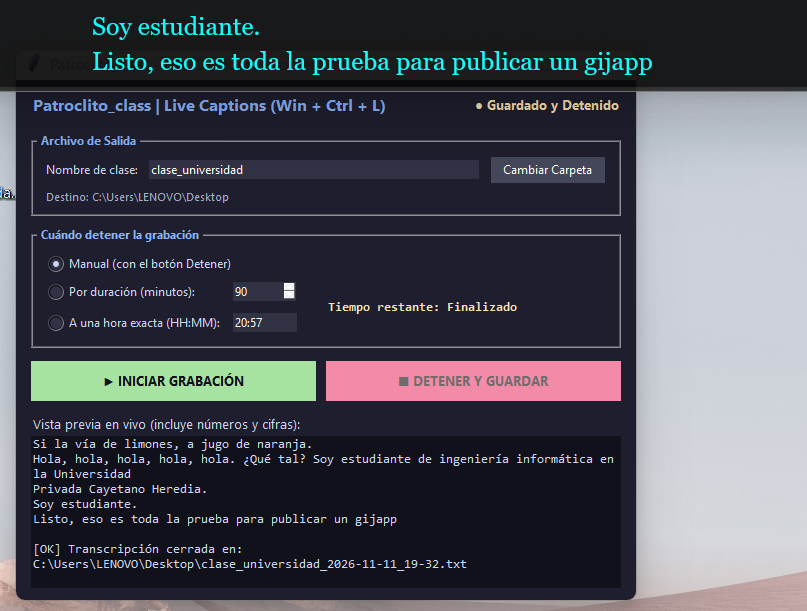

# Patroclito_class

**Record Windows 11 Live Captions into timestamped text files — built for students who want to study from what was actually said in class.**

Patroclito_class is a small, free, open-source Python app. It reads the text that Windows 11 **Live Captions** already shows on screen and saves it, line by line with timestamps, into a plain `.txt` file on your computer. Hours of lecture become text you can clean up, convert to Markdown, and feed to an AI assistant (ChatGPT, Claude, Gemini…) as study context.



*Keywords: save Windows Live Captions to text file, transcribe lectures, lecture notes from live captions, Live Captions to Markdown, student study tool.*

## Why this exists

I didn't invent anything new. I just noticed that no script existed to capture Microsoft's Live Captions into a file. Those captions are, in my experience, very good and fluid. I built this because I wanted to record (transcribe) my classes and study from the text.

My workflow: record the class → fix the text (even a good transcription can contain syntax or grammar errors, foreign words rendered phonetically, or local expressions) → save as `.md` → give it to an AI, tagged like HTML, so it has the context of hours of recording. The goal is to study from what was actually explained in class, because knowledge from lectures often fades from memory.

Made for students. Proposed in my hackathon *Nuevas Fronteras 2026* (2nd place).

## Privacy — please read

- **Everything stays local.** Captions are written only to a `.txt` file in the folder you choose on your own computer. Patroclito_class has no server, no account, no telemetry, and sends nothing over the network.
- Windows Live Captions itself runs on-device; this app only reads its text.
- **You are solely responsible for deciding whether to ask permission** before recording a class, a meeting or any conversation. Laws, university rules and instructors' policies differ. The author takes no responsibility for how you use this software.

## Requirements

- Windows 11 (version with **Live Captions**, 22H2 or later) 
- Live Captions turned on: press `Win + Ctrl + L`
- Python 3.10+ (only if running from source)

## Usage

### Option A — Download the app
Download `Patroclito_class.exe` from the [Releases](../../releases) page and run it.

### Option B — Run from source
```bash
pip install -r requirements.txt
python patroclito_class.pyw
```

1. Press `Win + Ctrl + L` to start Live Captions.
2. Open Patroclito_class, type a class name and (optionally) change the output folder.
3. Choose when to stop: manual, after N minutes, or at an exact time (HH:MM).
4. Click **START**. It keeps capturing in the background — other windows can be on top.
5. Click **STOP AND SAVE** (or wait for the timer). Your file looks like:

```
=== SESSION: CLASS_NAME (2026-11-11 08:00:00) ===

[08:00:12] Today we are going to talk about ...
[08:00:31] The result is 15% higher than ...
```

## Build the .exe

```bash
pip install pyinstaller
pyinstaller --noconfirm Patroclito_class.spec
```

## Notes

- It does not use the GPU: speech recognition is done by Windows; this app only polls the caption text (very low CPU use).
- Numbers and symbols are preserved when merging overlapping caption lines.
- "Microsoft" and "Windows" are trademarks of Microsoft Corporation. This project is independent and not affiliated with or endorsed by Microsoft.

## License

[MIT](LICENSE)
